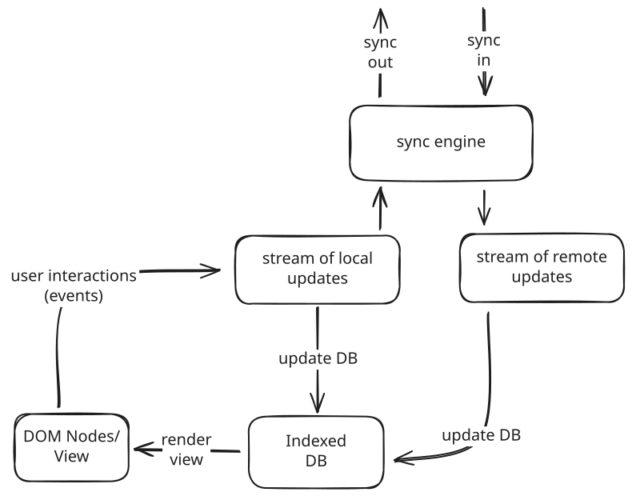

# Local-First Approaches for Cloud-Agnostic Collaborative Applications (LACCA)

This is the source code for a demonstrator developed in the context of the [LACCA Softwarecampus project](https://lacca.dev).
LACCA explores how collaborative applications can remain responsive, resilient, and privacy-preserving by synchronizing data directly between peers and functioning fully offline.
For more information see [this talk](https://www.youtube.com/watch?v=G6EiZuYayc0) in the context of the DATEV Software Craft Community.

<a href="https://www.youtube.com/watch?v=G6EiZuYayc0"></a>

This repo contains a Kanban-style project management application developed with local-first principles to enable collaboration without relying on centralized cloud services.

# Features
- Kanban board with columns representing task states. Create, move, and edit task cards.
- Modern reactive web UI
- Offline-Functionality via local in-browser data storage (indexedDB)
- Peer to peer sync over WebRTC (browser to browser) and WebSockets (browser to server)
- Peer to peer authentication using [UCAN](https://github.com/ucan-wg/spec) (proof of concept)

# Frontend

This is a local-first web application. Therefore, all data and the main business logic lives directly in the frontend in the browser.
The frontend implements roughly the following architecture:



## Development

Install npm dependencies.

```bash
  npm install
```

Build the scala.js project with [sbt](https://www.scala-sbt.org/). The first build takes a bit longer because the compiler will create typed facades for the npm dependencies (see [ScalablyTyped](https://scalablytyped.org/docs/readme.html) for more information on how this works).
The `~` automatically recompiles the project whenever the source code changes locally.

```bash
  sbt
  sbt:kanban> ~fastLinkJS
```

Once you have compiled the Scala code, you can run a local dev server to view the application in action:

```bash
  npm run dev
```

## Deployment

The project uses the [Vite](https://vite.dev/) build tool to bundle everything into a single Javascript package that is ready for deployment. The following command will build the project and output everything into the `dist` folder.
The output is a single page application that can be deployed using any static file server.

```bash
npm run deploy
```

A test version of this app is deployed at [Github Pages](https://stg-tud.github.io/lacca/).

# Backend (Optional)

If possible, this application uses direct peer to peer connections between clients to synchronize updates over [webrtc](https://github.com/dmotz/trystero).
Unfortunately, sometimes a direct client to client connection is not possible due to restrictive network environments. For these cases, this repo contains a simplistic Scala backend. The backend accepts client messages over a websocket connection and relays them to other clients.

The backend can be started using 
```bash
sbt server/run
```